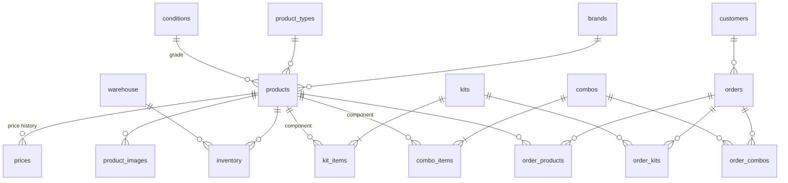

# MakMex Database

PostgreSQL 17 on Supabase. This folder documents the data model behind the MakMex storefront and employee tools: the tables, the SQL views that hold the pricing and availability logic, and the row-level security rules.

**Database design and data logic:** Jonathan Bonilla (team lead)

| File | What it contains |
|---|---|
| [`schema.sql`](schema.sql) | Tables, constraints, and foreign keys |
| [`views.sql`](views.sql) | Pricing, availability, catalog, and order views |
| [`security.sql`](security.sql) | Row-level security policies |

## At a glance

| | |
|---|---|
| Product records | 13,000+ |
| Warehouses | 3 |
| Kits / kit component lines | 3,400+ / 10,000+ |
| Combos / combo component lines | 139 / 697 |
| Price records | 13,000+ (dated history) |
| Brands · product types · condition grades | 47 · 12 · 7 |

The data was migrated from the business's Excel spreadsheets into this relational model.

## Data model

### Key design decisions

- **Condition-based pricing.** Each product stores one base price for condition grade AA (new). Every other grade is priced with a multiplier between 0 and 1 from the `conditions` table, so prices for all grades stay consistent with one source number.
- **Price history, not overwrites.** `prices` keeps dated rows. Views always use the latest price per product.
- **Bundles as junction tables.** Kits (tool + battery + charger) and combos reference their component products through `kit_items` and `combo_items`, each with its own quantity and bundle discount. Bundle data is never duplicated.
- **Inventory per warehouse.** One row per product per warehouse, enforced by a unique constraint.
- **Validation in the database.** CHECK constraints block negative stock and invalid quantities, limit kit roles to `tool`, `battery`, or `charger`, and keep condition multipliers in range. Foreign keys cascade where child rows have no meaning alone (images, prices, bundle lines) and restrict where history must survive (a product on an order cannot be deleted).

## Views

| View | Purpose |
|---|---|
| `product_price` | Selling price per product: latest base price × condition multiplier. Returns NULL if the product has no valid price. |
| `kit_price_calc`, `combo_price_calc` | Total bundle price from latest component prices, condition multipliers, discounts, and quantities. Returns NULL if any component has no valid price. |
| `kit_line_price_calc`, `combo_line_price_calc` | Line-by-line price breakdown for each bundle |
| `kit_availability`, `combo_availability` | How many complete bundles each warehouse can assemble from current stock |
| `products_with_images` | Products with their images as a JSON array, primary image first |
| `order_full_view` | Each order with its products, kits, and combos as JSON |

## Data quality audit (October 2026)

After the capstone, I audited the live database and fixed the following.

| Issue | Root cause | Fix | Impact |
|---|---|---|---|
| Kits and combos shown as available when they couldn't be assembled | Availability views used an `INNER JOIN` to inventory, so a component with no stock record at a warehouse was skipped instead of counted as zero | Check every bundle against every warehouse (`CROSS JOIN`) and treat missing stock as zero (`LEFT JOIN` + `COALESCE`) | Kits shown as available: 3,355 → 492. Combos: 133 → 49. |
| Bundles silently underpriced | `SUM()` ignores NULL, so a component with no price was treated as free | Return NULL for the bundle when any component lacks a valid price; use the latest dated price per product | 6 kits flagged; no other prices changed |
| Duplicate inventory rows | The same product/warehouse pair was imported more than once | Merged 32 duplicate rows (quantities summed) and added a unique constraint | Total stock unchanged at 5,160 units |
| Storefront showing random prices | The catalog requested whole tables in one call, but the API returns at most 1,000 rows (13,000+ products, 13,000+ prices, 10,000+ kit availability rows). Missing prices fell back to `Math.random()`; condition multipliers were never applied | Added a `product_price` view, paged all catalog queries, read kit and combo prices from their views, and removed every random fallback | Catalog prices now match the database; in-stock products, kits, and combos are no longer cut off at the first 1,000 rows |
| Customer and order data publicly readable | RLS policies allowed the public API key to read and insert customer and order rows | Removed browser access to sales tables; made `order_full_view` respect RLS; closed a public function endpoint | Customer PII no longer exposed |

Remaining items: 55 prices are null or zero (5 of those products are in stock), 15 products have no price row, and 51 price rows have no product attached. These need business input rather than a query fix.
